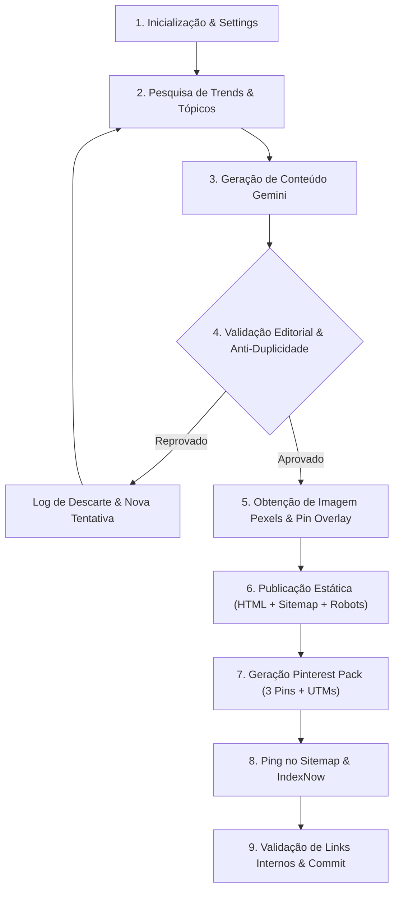

# Health PTG — Production Health Content & SEO Engine

Sistema automatizado de ponta a ponta para pesquisa, geração com IA, curadoria editorial científica, publicação estática (Cloudflare Pages) e automação de tráfego no Pinterest voltado para o público dos Estados Unidos.

---

## 📌 Sumário
- [Visão Geral](#-visão-geral)
- [O Que Foi Desenvolvido e Melhorias Recentes](#-o-que-foi-desenvolvido-e-melhorias-recentes)
- [Arquitetura e Fluxo do Pipeline (Início ao Fim)](#-arquitetura-e-fluxo-do-pipeline-início-ao-fim)
- [Configurações e Variáveis de Ambiente](#-configurações-e-variáveis-de-ambiente)
- [Estrutura do Repositório](#-estrutura-do-repositório)
- [Como Executar Localmente](#-como-executar-localmente)
- [Testes Automatizados e Validação](#-testes-automatizados-e-validação)
- [Deploy e Hospedagem (Cloudflare Pages)](#-deploy-e-hospedagem-cloudflare-pages)

---

## 🔬 Visão Geral

O **Health PTG** (*Practical US Health Notes*) é uma plataforma de conteúdo de saúde baseada em evidências científicas que roda 100% de forma automatizada via **GitHub Actions**, servindo páginas estáticas ultra-rápidas no **Cloudflare Pages** (`https://health-ptg.pages.dev`).

### Principais Pilares:
1. **Inteligência Artificial & Curadoria**: Geração via Google Gemini (`gemini-2.0-flash` / `gemini-3.6-flash`) com failover automático entre múltiplas chaves de API.
2. **Qualidade Científica & E-E-A-T**: Foco estrito em diretrizes de saúde do Google (YMYL), priorizando fontes institucionais e acadêmicas (NIH, CDC, FDA, periódicos revisados por pares).
3. **SEO Técnico Avançado**: URLs canônicas limpas (sem `.html`), Sitemap XML automatizado, Schema.org estruturado (`Article`, `BreadcrumbList`, `FAQPage`, `Recipe`, `WebSite`), meta tags Open Graph e Twitter Cards.
4. **Pinterest Traffic Automation**: Criação de imagens verticais de alta conversão (1000x1500) com overlay tipográfico, pacotes de rascunhos em CSV/JSON prontos para *Pinterest Bulk Upload* com links rastreados via UTMs e agendamento nos horários nobres dos EUA (ET).
5. **Indexação Orgânica & IndexNow**: Atualização contínua do sitemap XML canônico e notificação instantânea via protocolo IndexNow e ping nos motores de busca (em conformidade com as diretrizes do Google para blogs).

---

## 🚀 O Que Foi Desenvolvido e Melhorias Recentes

### 1. Infraestrutura SEO e Canonicidade
- **Eliminação de Conflito Crítico em `_headers`**: Removida a diretiva global `Link: <.../:splat.html>; rel="canonical"` que criava loops e conflitos de indexação no Google. Implementados headers de segurança (`X-Content-Type-Options: nosniff`, `X-Frame-Options: DENY`, `Referrer-Policy: strict-origin-when-cross-origin`).
- **Padronização de URLs Públicas sem `.html`**:
  - Home: `https://health-ptg.pages.dev/`
  - Artigos: `https://health-ptg.pages.dev/{slug}`
  - Categorias/Hubs: `https://health-ptg.pages.dev/tag/{tag}`
  - Sobre: `https://health-ptg.pages.dev/about`
  - Mantidos todos os arquivos físicos (`docs/{slug}.html`) intactos, com o Cloudflare Pages respondendo HTTP 200 direto através de *Clean URLs*.
- **Sitemap XML Reestruturado**: Nenhuma URL no `sitemap.xml` possui extensão `.html`. Todas as URLs listadas possuem arquivo físico correspondente e status 200.
- **Página 404 Otimizada**: Adicionada tag `<meta name="robots" content="noindex, follow">`, layout harmonizado com a marca e link limpo para a raiz `/`.

### 2. Qualidade Editorial, Rigor Científico e Conteúdo Útil (E-E-A-T)
- **Remoção de Personas Fictícias**: Eliminadas do prompt instruções que fabricavam relatos em 1ª pessoa ("*when I was diagnosed*", "*my personal struggle*").
- **Fontes Científicas Confiáveis e Links Diretos para Visualização**: Todo artigo cita fontes de alta autoridade e inclui links diretos e clicáveis (`<a href="..." target="_blank">`) apontando para as páginas dos estudos ou relatórios em bases consolidadas:
  - **PubMed (National Library of Medicine)**: Ensaios clínicos e literatura biomédica indexada.
  - **Europe PMC**: Artigos de acesso aberto e pesquisas biomédicas europeias/globais.
  - **Cochrane Library**: Revisões sistemáticas e ensaios clínicos controlados de padrão ouro.
  - Instituições públicas e periódicos de referência: NIH, CDC, WHO, FDA, The Lancet, NEJM, JAMA, BMJ.
- **Conteúdo Genuinamente Útil e Acionável**: Foco em protocolos diários práticos (dosagens seguras de alimentos, horários de ingestão, rotinas de sono e hábitos) para que o leitor consiga aplicar a ciência na vida cotidiana sem platitudes vagas.
- **Enriquecimento Científico Automático (`ensure_scientific_links`)**: Caso a IA gere citações em formato de texto sem hiperlink, o motor automaticamente analisa as referências e injeta links canônicos de visualização no PubMed, Europe PMC e Cochrane Library.
- **Proibição de Falsas Promessas**: Bloqueio de qualquer promessa de cura milagrosa, diagnósticos caseiros ou recomendações terapêuticas sem embasamento.
- **Motor de Validação Editorial (`validate_article_quality`)**: Analisador estático que valida contagem de palavras (mínimo de 480 palavras), variedade lexical (TTR >= 0.35 para evitar repetições de IA), presença comprovada de termos científicos, presença obrigatória de orientações práticas/acionáveis e links diretos para os estudos científicos antes de autorizar a publicação.
- **Transparência Institucional**: Bloco visual e semântico `editorial-notice` em cada artigo e atualização da página `about.html`.

### 3. Automação Pinterest & Geração de 3 Pins por Post
- **Garantia de Publicação Diária**: Sistema resiliente com até 6 tentativas por execução para assegurar que pelo menos 1 post completo seja publicado no dia (`POSTS_PER_DAY=1`), mesmo perante eventuais rejeições de similaridade semântica.
- **Estratégia de 3 Pins Diferenciados por Artigo**: De cada post publicado, são gerados automaticamente 3 Pins distintos para maximizar alcance e engajamento no Pinterest:
  1. **Pin Educacional (`educational`)**: Focado no mecanismo biológico, no funcionamento do corpo e guia passo a passo da evidência científica (agendado para o slot das 10:00 AM ET).
  2. **Pin Problema / Solução (`problem_solution`)**: Focado em frustrações, erros comuns a evitar, mitos e soluções práticas (agendado para o slot das 15:30 PM ET).
  3. **Pin de Pesquisas e Palavras-chave (`seo_search`)**: Focado nas buscas de alto volume do Pinterest US, listas e checklists com alta intenção de salvamento (agendado para o horário nobre das 20:30 PM ET).
- **Imagens e Rastreamento Individuais**:
  - Três imagens verticais PNG (1000×1500) com overlays de texto dedicados a cada ângulo (`_educational.png`, `_problem_solution.png`, `_seo_search.png`).
  - URLs com parâmetros UTM exclusivos:
    `?utm_source=pinterest&utm_medium=organic_social&utm_campaign={slug}&utm_content={pin_educational|pin_problem_solution|pin_seo_search}`.
  - Registro estruturado no `generated/pinterest/YYYY-MM-DD_pins.csv` no padrão exato do Pinterest Bulk Upload.
- **Pastas Nichadas (US Boards)**: Mapeamento determinístico de tags para pastas focadas no Pinterest (ex: `Better Sleep & Rest`, `Gut Health & Digestion`, `Healthy Recipes & Meal Prep`).

---

## 🔄 Arquitetura e Fluxo do Pipeline (Início ao Fim)

O fluxo principal é executado via `python -m src.app.run_daily` (localmente ou agendado no GitHub Actions):



### Detalhamento das Etapas:

1. **Inicialização (`src/app/config.py` e `src/app/state.py`)**:
   - Carrega chaves de API, variáveis de ambiente e o estado anterior (`generated/state.json`), que armazena os últimos tópicos, slugs recentes e histórico de rotação.
   - Verifica se a execução do dia deve ocorrer com base em `POSTS_PER_WEEK`.

2. **Descoberta de Tópicos (`src/app/trend_research.py` e `src/app/topics.py`)**:
   - Tenta identificar tendências em alta nos EUA via Google Trends / Reddit.
   - Se indisponível, aciona o algoritmo de rotação local inteligente de tags (`sleep`, `gut`, `stress`, `recipes`, `longevity`, `weight`, etc.), garantindo que nenhum tópico ou ângulo se repita em janelas curtas.

3. **Geração Estruturada (`src/app/gemini_client.py` e `src/app/content.py`)**:
   - O Gemini gera um JSON estrito contendo: título, slug, meta_description, HTML completo, termos de busca Pexels, pin_title, pin_description, pin_keywords, alt_text, tag e FAQ.
   - Se for da categoria `recipes`, inclui dados estruturados de receita (tempo, calorias, ingredientes, instruções).

4. **Validação Editorial, Rigor Científico & Anti-Plágio (`src/app/duplicate_checker.py` e `src/app/content.py`)**:
   - O artigo passa por `ensure_scientific_links` para garantir que as referências contenham links diretos clicáveis para PubMed, Europe PMC ou Cochrane Library.
   - O artigo passa por `validate_article_quality`: verifica extensão mínima (480 palavras), termos científicos, presença de links científicos clicáveis, presença de conteúdo prático/acionável para o leitor, variedade vocabular (TTR >= 0.35) e ausência de anedotas inventadas ou promessas de cura.
   - O `DuplicateChecker` analisa similaridade semântica contra a base de artigos já publicados. Se houver sobreposição excessiva, o post é descartado e o pipeline tenta outro tópico até atingir a meta diária (até 6 tentativas).

5. **Aquisição de Mídia Visual & Overlays para os 3 Pins (`src/app/images.py`)**:
   - Busca uma imagem hero horizontal em alta definição no Pexels e a salva em `docs/assets/YYYY-MM-DD_slug.jpeg`.
   - Gera 3 imagens verticais 1000x1500 em PNG (`_educational.png`, `_problem_solution.png`, `_seo_search.png`) com composições tipográficas dedicadas a cada um dos 3 ângulos estratégicos.

6. **Compilação e Atualização do Site (`src/app/site.py`)**:
   - Injeta IDs nos títulos H2 e gera Table of Contents (TOC).
   - Injeta links internos de artigos relacionados (`#recent-1` a `#recent-5`).
   - Compila o arquivo físico `docs/{slug}.html`.
   - Regenera a página inicial (`docs/index.html`), todas as páginas de categorias (`docs/tag/{tag}.html`), a página institucional (`docs/about.html`), o arquivo `docs/robots.txt` e o `docs/sitemap.xml` com URLs canônicas limpas.

7. **Pinterest Triple Pins Pack & Rastreamento (`src/app/pinterest_drafts.py` e `src/app/pinterest_seo.py`)**:
   - A função `generate_triple_pins` gera os 3 conjuntos de metadados: Educacional (10:00 AM), Problema/Solução (15:30 PM) e Buscas/Keywords (20:30 PM).
   - Formata as URLs de destino com parâmetros UTM específicos (`utm_content=pin_educational`, `pin_problem_solution`, `pin_seo_search`).
   - Gera o arquivo `generated/pinterest/YYYY-MM-DD_pins.csv` contendo as 3 entradas prontas para o *Pinterest Bulk Upload*.
   - Registra cada pin no histórico do `PinterestPerformanceTracker`.
   - Se `PINTEREST_ENABLE_PUBLISH=1`, realiza publicação direta via Pinterest API v5.

8. **Notificação de Motores de Busca (Sitemap Ping & IndexNow)**:
   - Notifica os motores de busca através do sitemap XML atualizado.
   - Envia sinal para o protocolo IndexNow (Bing, Yandex, etc.) para rastreamento prioritário.

9. **Validação Final e Salvamento do Estado**:
   - Executa `validate_links.py` para garantir que nenhuma página tenha links quebrados.
   - Salva o novo estado em `generated/state.json`.

---

## ⚙️ Configurações e Variáveis de Ambiente

As variáveis podem ser configuradas no arquivo `.env` local ou nos Secrets / Variables do repositório no GitHub:

| Variável | Tipo | Obrigatória | Descrição |
| :--- | :---: | :---: | :--- |
| `GEMINI_API_KEY_1` | Secret | **Sim** | Chave principal da API Google Gemini. |
| `GEMINI_API_KEY_2..4` | Secret | Não | Chaves sobressalentes para rotação automática em caso de rate limit (429). |
| `GEMINI_MODEL` | Variable | Não | Modelo utilizado (padrão: `gemini-3.6-flash` ou `gemini-2.0-flash`). |
| `PEXELS_API_KEY` | Secret | **Sim** | Chave da API Pexels para download das imagens hero. |
| `BASE_URL` | Variable/Secret | Não | URL pública do site (padrão: `https://health-ptg.pages.dev`). |
| `SITE_TITLE` | Variable | Não | Título institucional do site (padrão: `Practical US Health Notes`). |
| `POSTS_PER_DAY` | Variable | Não | Quantidade de posts publicados por execução (padrão: `1`). |
| `POSTS_PER_WEEK` | Variable | Não | Dias da semana ativos para publicação (padrão: `7`). |
| `PINTEREST_ENABLE_PUBLISH` | Variable | Não | Ativa publicação direta via API (`1` para ativar, padrão: `0`). |
| `PINTEREST_ACCESS_TOKEN` | Secret | Não | Token OAuth com permissões `boards:read`, `pins:write`. |
| `PINTEREST_BOARD_ID` | Secret | Não | ID do board fallback caso publicação via API esteja ligada. |
| `INDEXNOW_KEY` | Secret | Não | Chave para notificação instantânea de motores de busca compatíveis com IndexNow. |

---

## 📂 Estrutura do Repositório

```text
Pin/
├── .github/
│   └── workflows/
│       ├── daily.yml                 # Workflow diário cron (10:10 UTC)
│       ├── preview.yml               # Validação de PRs e previews
│       └── delete_post.yml           # Workflow para remoção controlada de posts
├── docs/                             # Diretório de publicação servido pelo Cloudflare Pages
│   ├── _headers                      # Cabeçalhos HTTP de segurança e MIME do sitemap
│   ├── 404.html                      # Página de erro 404 (noindex, follow)
│   ├── about.html                    # Página Sobre e Padrões Editoriais
│   ├── index.html                    # Homepage gerada com hero split, hubs e busca
│   ├── posts.json                    # Registro central de artigos publicados
│   ├── robots.txt                    # Configuração para crawlers apontando para o sitemap
│   ├── sitemap.xml                   # Sitemap XML com URLs canônicas sem .html
│   ├── assets/                       # Estilos CSS, logos e imagens hero dos artigos
│   ├── tag/                          # Hubs de tópicos (sleep.html, gut.html, etc.)
│   └── *.html                        # Arquivos físicos dos artigos gerados
├── generated/                        # Artefatos gerados pelo sistema
│   ├── state.json                    # Histórico de execução, rotação e memória de tópicos
│   ├── content_index.json            # Base de embeddings/termos para detecção de duplicatas
│   ├── pinterest_performance.json    # Histórico de performance e aprendizado do Pinterest
│   ├── logs/                         # Logs de execução, erros e indexação
│   └── pinterest/                    # Pins verticais PNG, CSVs e JSONs de agendamento
├── src/
│   └── app/
│       ├── config.py                 # Carregamento e validação de configurações
│       ├── content.py                # Prompt Gemini, normalização e validação editorial
│       ├── duplicate_checker.py      # Verificador de similaridade de conteúdo
│       ├── gemini_client.py          # Cliente HTTP resiliente para a API do Gemini
│       ├── images.py                 # Download do Pexels e renderização PIL do Pin vertical
│       ├── indexing.py               # Módulo de stub (Google Indexing API descontinuada para blogs)
│       ├── internal_links.py         # Algoritmo de interlinkagem contextual entre posts
│       ├── pinterest_api.py          # Publicação direta na API v5 do Pinterest
│       ├── pinterest_drafts.py       # Gerador do CSV Bulk Upload e JSON do Pinterest
│       ├── pinterest_performance.py  # Rastreador e motor de aprendizado do Pinterest
│       ├── pinterest_seo.py          # Extração de intents, keywords long-tail e boards
│       ├── repair_site.py            # Script utilitário para reparo e normalização do site
│       ├── run_daily.py              # Orquestrador mestre da esteira diária
│       ├── site.py                   # Gerador de páginas HTML, sitemap e schemas
│       ├── titles.py                 # Geração e refinamento de títulos de alta conversão
│       ├── topics.py                 # Rotação determinística e balanceamento de tópicos
│       ├── trend_research.py         # Pesquisa de tendências (Google Trends/Reddit)
│       ├── validate_links.py         # Validador de integridade de links internos
│       └── verify_seo.py             # Verificador de integridade de metadados SEO
├── tests/
│   └── test_seo_and_quality.py       # Suíte completa de testes automatizados
├── requirements.txt                  # Dependências Python do projeto
├── wrangler.jsonc                    # Configuração do Cloudflare Pages
└── README.md                         # Esta documentação
```

---

## 💻 Como Executar Localmente

### 1. Pré-requisitos
- Python 3.11 ou superior
- Git

### 2. Configuração do Ambiente Virtual
```bash
# Clone o repositório
git clone https://github.com/rodrigosimoes97/Pin.git
cd Pin

# Crie e ative o ambiente virtual
python -m venv .venv

# Windows (PowerShell):
.venv\Scripts\Activate.ps1

# Linux / macOS:
source .venv/bin/activate

# Instale as dependências
pip install -r requirements.txt
```

### 3. Executando o Pipeline Completo
Defina as variáveis de ambiente necessárias e execute o orquestrador:
```bash
# Exemplo no PowerShell:
$env:GEMINI_API_KEY_1="sua-chave-gemini"
$env:PEXELS_API_KEY="sua-chave-pexels"
$env:BASE_URL="https://health-ptg.pages.dev"
$env:POSTS_PER_DAY="1"

python -m src.app.run_daily
```

### 4. Executando o Reparo e Regeneração Estática
Caso queira recalcular índices, normalizar canonicals e reconstruir a home e o sitemap a partir de `posts.json`:
```bash
python -m src.app.repair_site
```

---

## 🧪 Testes Automatizados e Validação

O projeto possui cobertura completa de testes automatizados que garantem a consistência antes de qualquer alteração ir para produção.

### Rodar a Suíte Completa de SEO e Qualidade Editorial:
```bash
python -m unittest tests/test_seo_and_quality.py
```
*Valida: ausência de `.html` no sitemap, canônicos apontando para arquivos físicos existentes, integridade dos cabeçalhos HTTP, robôs, integridade de links internos e regras editoriais contra curas milagrosas e relatos fictícios.*

### Rodar o Verificador de SEO:
```bash
python -m src.app.verify_seo
```

### Rodar o Validador de Links Internos:
```bash
python -m src.app.validate_links
```

### Rodar os Testes de Pinterest & Features:
```bash
python test_pinterest_features.py
```

---

## ☁️ Deploy e Hospedagem (Cloudflare Pages)

O site é hospedado através do **Cloudflare Pages**, com o build configurado para servir diretamente a pasta `docs/`.

### Configuração recomendada no painel da Cloudflare:
- **Build Output Directory**: `docs`
- **Root Directory**: `/`
- **Pretty URLs (Clean URLs)**: **Ativado** (*Automaticamente serve `/slug.html` em `/slug` com status 200*).
- O arquivo `docs/_headers` é aplicado automaticamente pela Cloudflare a cada build/deploy.
